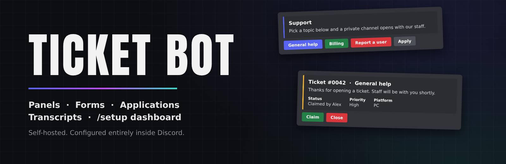
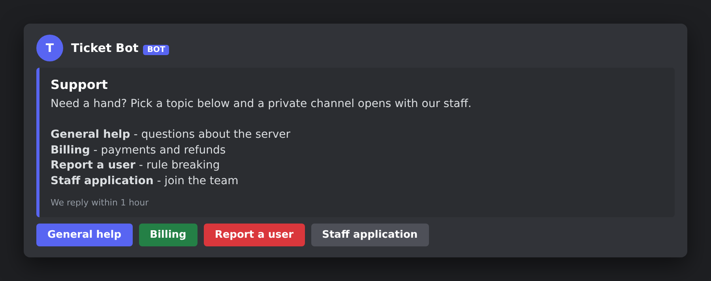
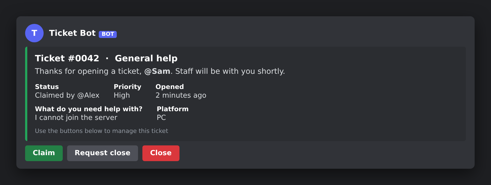
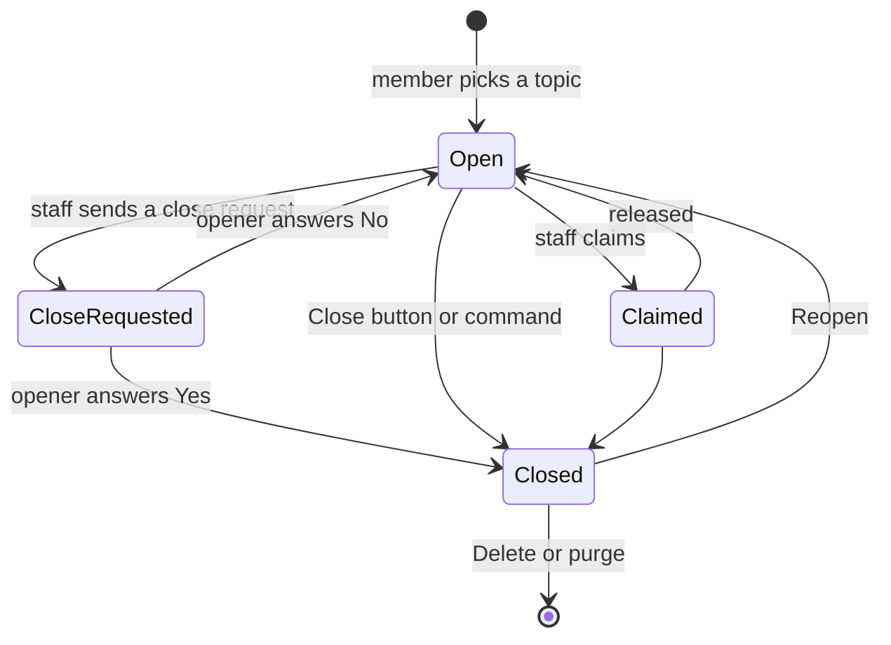
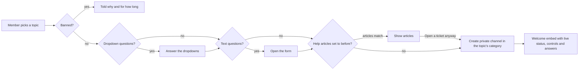

<div align="center">



<br>

[](https://github.com/Just9OO/900TicketBot/actions/workflows/ci.yml)
[](https://github.com/Just9OO/900TicketBot/releases)
[](https://github.com/Just9OO/900TicketBot/commits)
[](https://github.com/Just9OO/900TicketBot/stargazers)
[](https://nodejs.org)
[](https://discord.js.org)
[](https://www.sqlite.org)
[](#license)

**A self-hosted Discord ticket bot.** Members open private ticket channels from a panel, staff claim and close them, and every ticket gets a transcript, a status and a log entry. It is configured entirely from inside Discord with a `/setup` dashboard.<br>
Your server, your data, your look.

[**Features**](#at-a-glance) · [**Quick start**](#quick-start) · [**Guide**](#usage-guide) · [**Commands**](#command-reference) · [**Deployment**](#deployment) · [**Troubleshooting**](#troubleshooting) · [**Changelog**](CHANGELOG.md)

</div>

---

<div align="center">

 

<sub>Mock-ups of the panel and the ticket welcome message.</sub>

</div>

---

## At a glance

<table>
<tr>
<td width="50%" valign="top">

### 🎨 Look
- Panels with title, colour, banner and footer
- Button or dropdown, up to 25 topics
- Colour for every button
- Live preview while you edit

</td>
<td width="50%" valign="top">

### 🎛️ Control
- **`/setup` dashboard**: pickers, toggles, forms
- Forms with text and dropdown questions
- Per-topic staff role, category and transcripts
- Share panels as `.json` templates

</td>
</tr>
<tr>
<td width="50%" valign="top">

### 🎫 Tickets
- Claim, release, transfer, close requests
- **Priority**: low, high, urgent
- Live status on the welcome message
- `/mytickets` and a "Go to your ticket" button

</td>
<td width="50%" valign="top">

### 🛡️ Reliable
- Staff applications with Accept or Deny and DM
- Ticket log channel and ticket bans
- HTML transcripts and 1 to 5 star ratings
- `Guilds` intent only, one SQLite file

</td>
</tr>
</table>

---

## Overview

Members get a private channel with your staff in one click. You post a **panel** (a message with buttons or a dropdown) and members open tickets from it. Each entry on the panel, called a **topic**, can have its own staff role, Discord category, form questions and transcript channel, or be turned into a staff **application**.

Everything is set up from one private screen, `/setup`, with pickers, toggles and a live preview, so there are no command options to memorise.

It runs as a single process with an embedded SQLite database. There is no web dashboard to secure, and it needs no privileged intents.

## How it works





**Panels and topics.** A panel is the message members click. A topic is one button (or dropdown entry) on it. Anything you leave empty on a topic falls back to the panel's setting, so a basic panel needs no per-topic configuration.

## Quick start

### Prerequisites

- **Node.js 22 or newer** (24 LTS recommended)
- A Discord account that can add a bot to your server

### 1. Create the bot

1. Open the [Discord Developer Portal](https://discord.com/developers/applications) and create a **New Application**.
2. Go to **Bot**, then **Reset Token**, and copy the token. Keep it secret.
3. No privileged intents are needed. Leave them all off.

### 2. Invite it

Replace `YOUR_CLIENT_ID` with your application's ID (**General Information**):

```
https://discord.com/oauth2/authorize?client_id=YOUR_CLIENT_ID&permissions=268561424&scope=bot%20applications.commands
```

| Permission | Why it is needed |
| --- | --- |
| Manage Channels | Create and delete ticket channels and categories |
| View Channels, Send Messages, Embed Links | Post panels and ticket messages |
| Attach Files, Read Message History | Build and upload transcripts |
| Manage Messages | Lets staff manage messages inside tickets |
| Manage Roles | Edit who can type in a ticket and grant roles to accepted applicants. The bot's role must sit **above** any role it gives |

### 3. Install and run

```bash
git clone https://github.com/Just9OO/900TicketBot.git
cd 900TicketBot
npm install
cp .env.example .env      # then edit .env and paste your token
npm start
```

On the first start the bot creates `data/tickets.db` and registers its slash commands. While testing, set `GUILD_ID` so commands appear instantly instead of after up to an hour.

### 4. Post your first panel

Run `/setup` in your server (you need **Manage Server**), press **New panel**, pick the channel and your staff role, adjust the look, and press **Post**.

## Configuration

| Variable | Required | Default | Description |
| --- | :---: | --- | --- |
| `DISCORD_TOKEN` | :white_check_mark: | | Your bot token |
| `GUILD_ID` | | *(global)* | Register slash commands to one server (instant). Leave empty for a public bot |
| `DB_PATH` | | `./data/tickets.db` | Where the SQLite database is stored |
| `MAX_TRANSCRIPT_MESSAGES` | | `5000` | Messages per transcript. Longer tickets keep the most recent ones |
| `CREATE_COOLDOWN_SECONDS` | | `10` | Seconds a member must wait between opening tickets |

## Usage guide

### The `/setup` dashboard

`/setup` opens a private message only you can use (it expires after 30 minutes of inactivity). From the home screen you can start a **New panel** or pick an existing one to **edit** or **delete** (deleting asks you to confirm).

The editor has three pages (the breadcrumb at the top shows where you are, and warns what is still missing):

| Page | What you set |
| --- | --- |
| **Main** | Panel type, staff role, channel, transcript channel, live preview, and the **Text & look** button (title, text, banner, footer, colour) |
| **Settings** | Toggles (claim button, ratings, form, category per topic, topic list on the panel), help-article timing, shared category, and **Form & limits** |
| **Topics** | Add, edit and remove topics. For each: label, emoji, button colour, own staff role, own category, own questions, ticket or application |

The preview is the real panel embed, so what you see is what members get. Staff role cannot be `@everyone`.

### Making your panel look good

| Option | Where | Notes |
| --- | --- | --- |
| Title and colour | `/setup` Main > Text & look, or `title` and `color` on `/panel create` | Colour is hex such as `#5865F2` |
| Banner | `image` | A direct `http(s)` link to an image |
| Footer | `footer` | For example `We reply within 1 hour` |
| Topic list | `/setup` Settings | Lists every topic with its description inside the embed |
| Button colours | `/setup` Topics, or `/panel topic add button_color:` | Blue, grey, green or red |

### Forms and dropdown questions

Turn a form on for any panel or topic. Separate questions with `|` or a new line. Put options in square brackets to make a dropdown:

```text
What do you need help with? | Platform? [PC, Console, Mobile] | Server name
```

- Up to **5 questions**, and at most **4 of them dropdowns**
- Labels up to 45 characters, each option up to 100 characters, up to 25 options
- Members answer the dropdowns first (a message with the selects and a **Continue** button), then the text form, then the ticket opens
- All answers appear as fields in the ticket's welcome message

Set questions on the panel with `/panel questions` or on one topic with `/panel topic edit`. Topics inherit the panel's questions unless they have their own.

### Live ticket status

The welcome message of every ticket has a **Status** field and matching embed colour that update by themselves:

| State | Shown |
| --- | --- |
| Open | Open, waiting for staff |
| Claimed | Claimed by the staff member |
| Closed | Closed, with the reason |
| Applications | Pending, Accepted or Denied |

Channel names are not changed to show status because Discord limits renames to 2 per 10 minutes per channel.

### Applications

Turn a topic into an application (the **Kind** button in `/setup` Topics, or `kind:application` on `/panel topic add`). The topic needs its own questions. The applicant fills the form, a private review channel opens, and staff press **Accept** (optionally granting a role) or **Deny** (with a reason). The applicant is told by DM.

### Ticket log

```text
/admin log channel:#ticket-log     # start logging
/admin log off:true                # stop
```

Opens, claims, closes, reopens, deletes, bans and application decisions are recorded as embeds. If the channel is deleted or the bot loses access, logging quietly does nothing.

### Ticket bans

```text
/admin ban user:@Member reason:"Spamming tickets" duration:7d
/admin unban user:@Member
/admin banlist
```

Durations: `30m`, `12h`, `7d`, `2w` or `perm`. A banned member who presses a panel button is told the reason and when it ends. Bans expire on their own.

### Panel templates

```text
/panel export panel:1              # the bot replies with a .json file
/panel import file:<template.json> channel:#support staff_role:@Support
```

A template holds the look, topics, questions and settings. It does **not** hold roles or channels, so you choose them when importing. Import accepts only a `.json` file up to 100 KB, allows banner images only from Discord's own CDN, and validates everything before posting.

### Help articles

`/articles add` opens a form for a new article. `/articles link` ties an article to a topic so it is shown before (or inside) the ticket, and `/faq` lets anyone search articles.

### Inside a ticket

`/close` and `/claim` are top-level shortcuts. Everything else is under `/ticket`: `info`, `priority`, `transfer`, `claim`, `close`, `request-close`, `add`, `remove`, `rename`, `reopen`, `delete`, and `open` (open a ticket for a member).

## Command reference

| Command | What it does | Who |
| --- | --- | --- |
| `/setup` | The dashboard for creating, editing and deleting panels | Manage Server |
| `/panel create` | Create a panel from options (the typed way) | Manage Server |
| `/panel list` / `/panel delete` | List or delete panels | Manage Server |
| `/panel questions <panel> [enabled] [questions]` | Turn the form on or off and set its questions | Manage Server |
| `/panel topic add/edit/remove/list` | Manage the buttons or dropdown entries | Manage Server |
| `/panel export` / `/panel import` | Move a panel between servers as a template | Manage Server |
| `/articles add/remove/list/link/unlink` | Help articles | Manage Server |
| `/admin log [channel] [off]` | Set or turn off the ticket log | Manage Server |
| `/admin ban/unban/banlist` | Block members from opening tickets | Manage Server |
| `/admin purge [scope]` | Bulk-delete ticket channels | Administrator |
| `/stats` | Ticket counts and ratings | Manage Server |
| `/close [reason]` | Close the current ticket | Staff or opener |
| `/claim` | Claim or release the current ticket | Staff |
| `/ticket claim/transfer/priority/close/request-close/add/remove/rename/reopen/delete/open` | Manage tickets | Staff |
| `/ticket info` | Details of the current ticket | Anyone in the ticket |
| `/mytickets` | Your own open tickets | Everyone |
| `/faq` | Search help articles | Everyone |
| `/ping` | Show latency | Everyone |
| `/help` | Show all commands | Everyone |

## Architecture

```text
|-- src/
|   |-- index.js            # Client setup, cache limits, startup, shutdown
|   |-- config.js           # Environment variables and constants
|   |-- db.js               # Opens SQLite, prepares every statement once
|   |-- sql.js              # Schema, migrations and all SQL (no driver imports)
|   |-- deploy.js           # Registers slash commands only when they changed
|   |-- handlers.js         # Routes interactions to commands and button/modal handlers
|   |-- actions.js          # Shared logic for slash commands and buttons
|   |-- setup.js            # The /setup dashboard
|   |-- session.js          # Short-lived, per-user dashboard and form state
|   |-- panels.js           # Create, update, delete, export and import panels
|   |-- tickets.js          # Open, close, reopen, delete, permissions, live status
|   |-- topics.js           # Topic settings, inheritance, form and dropdown questions
|   |-- topicCommands.js    # The /panel topic subcommands
|   |-- bans.js             # Ticket bans and duration parsing
|   |-- log.js              # Ticket log channel
|   |-- survey.js           # Rating prompts and delivery
|   |-- knowledge.js        # In-memory help-article search
|   |-- transcript.js       # Collects messages over REST and delivers the file
|   |-- transcriptHtml.js   # Pure HTML renderer for transcripts
|   |-- autocomplete.js     # Autocomplete for panels, topics and articles
|   |-- ui.js               # Every embed, button, dropdown and modal
|   `-- commands/           # One file per slash command, loaded automatically
|-- docs/                   # Banner, mock-ups and social preview
|-- scripts/check.js        # npm run check: parses every file
|-- .github/                # CI, Dependabot, issue and PR templates
|-- .env.example
|-- package.json
|-- CHANGELOG.md
|-- CONTRIBUTING.md
|-- SECURITY.md
`-- README.md
```

Adding a command means adding one file to `src/commands/` that exports `data` (a `SlashCommandBuilder`) and `execute(interaction)`.

### Why it's fast

- **`Guilds` intent only.** Slash commands, buttons, dropdowns and forms arrive as interactions. Transcripts are read over REST.
- **Tight caches.** Messages, reactions, presences, threads and emojis are not cached, and users and members are capped.
- **SQLite in WAL mode.** Every statement is compiled once, and the hot lookups are indexed.
- **Commands register only on change.** A hash of the definitions is stored in the database, so a normal restart makes no registration calls. Commands are grouped (`/panel`, `/ticket`, `/admin`) to stay well under Discord's size limits.
- **Work in parallel.** Closing a ticket builds the transcript, locks the opener and sends the rating prompt concurrently.

### Database

| Table | Purpose |
| --- | --- |
| `panels` | Posted panels, their look, default settings, form switch and questions |
| `topics` | Buttons or dropdown entries, with optional overrides and button colour |
| `tickets` | Every ticket and application, including claim, close and decision state |
| `surveys` | Rating prompts and answers. Kept after the ticket is deleted |
| `kb_articles` | Help articles |
| `bans` | Members blocked from opening tickets |
| `guild_settings` | Per-server settings such as the log channel |
| `counters` | Per-server ticket numbers, never reused |
| `meta` | Internal values such as the command definition hash |

Columns added after the first release are applied by a migration step on startup, so an existing database is upgraded in place.

## Deployment

The bot is one Node process and one SQLite file. Any host that keeps a persistent disk works.

### Process manager

```bash
npm install -g pm2
pm2 start src/index.js --name 900-ticket-bot
pm2 save && pm2 startup
```

### systemd

```ini
# /etc/systemd/system/900-ticket-bot.service
[Unit]
Description=Ticket Bot
After=network-online.target

[Service]
WorkingDirectory=/opt/900-ticket-bot
ExecStart=/usr/bin/node src/index.js
Restart=always
User=ticketbot

[Install]
WantedBy=multi-user.target
```

### Data and backups

- All state is in `data/tickets.db` (set `DB_PATH` to move it). On container or PaaS hosts, put it on a **persistent volume**, otherwise tickets are lost on redeploy.
- Back it up while running with `sqlite3 data/tickets.db ".backup 'backup.db'"`.
- The bot checkpoints the WAL file and closes the database on `SIGINT` and `SIGTERM`.

### Updating

```bash
git pull
npm install
# restart the process
```

Database changes are migrated automatically on startup, and slash commands are re-registered if their definitions changed.

**Upgrading from 1.x:** the old top-level commands `/topic`, `/form`, `/open`, `/add-user`, `/remove-user`, `/rename`, `/delete`, `/request-close` and `/roleall` are gone. Their replacements are listed in the [changelog](CHANGELOG.md). Old panels keep working and can be opened in `/setup`.

## Troubleshooting

<details>
<summary><b>Slash commands don't appear</b></summary>

Global commands can take up to an hour to show up. Set `GUILD_ID` in `.env` to register to one server instantly. Also check the bot was invited with the `applications.commands` scope. After updating from 1.x, restart the bot so the new grouped commands are registered.
</details>

<details>
<summary><b>"I could not create your ticket"</b></summary>

The bot is missing **Manage Channels**, or the category is full (Discord allows 50 channels per category and 500 per server). Pick a category with room.
</details>

<details>
<summary><b>I cannot send embeds / files in that channel</b></summary>

Panel commands check the bot's permissions in the target channels. Grant View Channel, Send Messages and Embed Links, plus Attach Files for the transcript channel.
</details>

<details>
<summary><b>The /setup screen says it expired</b></summary>

The editor keeps its state in memory for 30 minutes and only for the person who opened it. Run `/setup` again. Restarting the bot also clears open editors. Saved panels are not affected.
</details>

<details>
<summary><b>The ticket log stays empty</b></summary>

Check `/admin log` points at a channel the bot can View and Send Messages and Embed Links in. If the bot cannot post there, logging is skipped silently so tickets keep working.
</details>

<details>
<summary><b>A template will not import</b></summary>

Templates must be a `.json` file up to 100 KB exported by `/panel export`. Banner images must be Discord CDN links. The error message lists what is wrong.
</details>

<details>
<summary><b>Accepted applicants don't get their role</b></summary>

The bot needs **Manage Roles**, and its highest role must be **above** the role it is giving. Move the bot's role up in **Server Settings > Roles**.
</details>

<details>
<summary><b>Ratings or transcripts aren't arriving</b></summary>

Ratings are delivered to the transcript channel, so set one on the panel or topic. Transcripts are also DMed to the opener, which fails silently if their DMs are closed.
</details>

<details>
<summary><b>"GLIBC_2.38 not found" or ERR_DLOPEN_FAILED on a host</b></summary>

The host's Linux is older than the prebuilt better-sqlite3 binary needs. The bot now handles this itself: it prints `[db] better-sqlite3 could not load` and uses Node's built-in SQLite, as long as Node is 22.5 or newer (24 LTS recommended). Pick a newer Node version in the host's panel if you see the error `built-in fallback needs Node.js 22.5`.
</details>

<details>
<summary><b><code>npm install</code> fails on better-sqlite3</b></summary>

`better-sqlite3` ships prebuilt binaries for common Node versions and platforms. If none matches yours, it compiles from source, which needs Python 3 and a C++ toolchain (`build-essential` on Debian and Ubuntu, Xcode command line tools on macOS). Using an LTS version of Node (22 or newer) avoids this in most cases.
</details>

<details>
<summary><b>Renaming a ticket seems slow</b></summary>

Discord allows only 2 channel renames per 10 minutes per channel. `/ticket rename` tells you when the change is queued.
</details>

## Limits to know about

| Limit | Value | Source |
| --- | --- | --- |
| Topics per panel | 25 | One dropdown, or 5 rows of 5 buttons |
| Form questions | 5 (4 dropdowns at most), 45 characters each, 900 per text answer | Discord form limits |
| Dropdown options per question | 25, 100 characters each | Discord select limits |
| Help articles per server | 100 | Keeps the in-memory index small |
| Categories per server | 50 | Discord limit |
| Template file | 100 KB | Safety limit |
| Transcript size | `MAX_TRANSCRIPT_MESSAGES` (5000) | Configurable |


## FAQ

**Do I need any privileged intents?** No. The bot uses only the `Guilds` intent. Transcripts are read over REST.

**Can one bot run on several servers?** Yes. Leave `GUILD_ID` empty to register commands globally. All data is stored per server.

**Can I run two separate bots?** Yes. Give each copy its own folder, `.env` and database (`DB_PATH`).

**Where is my data?** In one SQLite file, `data/tickets.db`. See [Data and backups](#data-and-backups).

**Which Node.js version should I use?** Node 24 LTS is recommended. Node 22 is the minimum. Node 20 is end of life and not supported.

**Can members reopen their own closed ticket?** No. Reopening is staff only (Administrator, Manage Channels or the panel's staff role).

## Contributing

Bug reports, ideas and pull requests are welcome. Read [CONTRIBUTING.md](CONTRIBUTING.md) for setup and style, and use the issue templates when reporting a problem.

## Security

Never commit `.env`, and reset your token in the Developer Portal if it leaks. To report a vulnerability, use a [private security advisory](https://github.com/Just9OO/900TicketBot/security/advisories/new). See [SECURITY.md](SECURITY.md).

## License

Released under the [MIT License](LICENSE).
